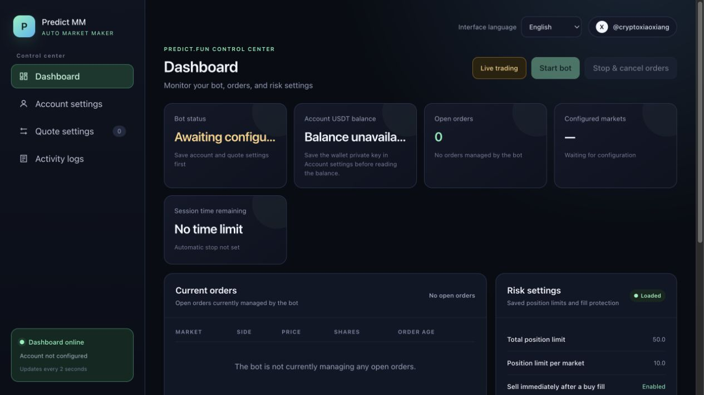

# Predict.fun Market Making Bot

[简体中文](README.md) | [English](README.en.md)

A Predict.fun market making tool with a web dashboard, multi-market quoting, automatic cancellation and repricing, and fill monitoring. Available as a Windows desktop app or a service on an Ubuntu/Debian VPS.

**[Download for Windows](https://github.com/Cryptoxiaoxiang/predict-mm-bot/releases/download/v0.1.0-windows-preview.2/PredictMMBot-Windows-x64.zip)** · [Windows instructions](#windows-desktop-app) · [One-command VPS installation](#one-command-vps-installation)

> Orders can fill. This tool cannot guarantee that orders will remain unfilled or that emergency sells will execute at a particular price. Try dry-run mode first, then start with a small amount.



## Features

- Web dashboard: configure your account and markets, control the bot, and view its status.
- Chinese and English interface: switch languages at the top right; the app remembers your choice.
- Market URL lookup: paste a Predict.fun market URL and choose the outcome to quote.
- Multiple markets: manage several markets with separate outcomes and order sizes.
- Automatic quoting: place, cancel, and reprice orders using the order book and configured lifetime.
- Short-lived orders: quickly remove canceled orders from the book; signed limit orders expire within 300 seconds.
- Price proximity protection: cancel when the market approaches a resting order, with periodic checks as a fallback when the live connection drops.
- Bid depth protection: cancel when bids ahead of your order become too thin or decline quickly; resume after depth recovers.
- Fill monitoring: use real-time notifications and order queries to detect filled buy orders.
- Emergency selling: pause the affected market and attempt to sell after a buy-match notification, retrying when shares are not yet available; this may use existing holdings of the same outcome.
- Logs: inspect quoting, cancellation, and fill-protection activity.

## Before you start

- Use a separate wallet for the bot if possible. Predict.fun registration link: [https://predict.fun?ref=5BA3F](https://predict.fun?ref=5BA3F).
- Have your Predict.fun API Key, Predict wallet address, and signing wallet private key ready. The dashboard generates the JWT automatically when you save the account settings.

## Account setup

1. Request an API Key through [Predict.fun Developers](https://developers.predict.fun/). An account setup walkthrough is available [on X](https://x.com/cryptoxiaoxiang/status/2095794263439397155).
2. On the Predict.fun website, click your profile picture and copy the wallet address below your username.
3. For a Predict account, export the Privy signing wallet private key from the website's profile/settings menu.
4. Enter the copied wallet address, API Key, and Privy private key in the bot's account settings and save.
5. For a new wallet, the current setup instructions require completing a trade on the official website to establish trading approvals.

## Windows desktop app

1. Open the **[Windows download page](https://github.com/Cryptoxiaoxiang/predict-mm-bot/releases)** and download `PredictMMBot-Windows-x64.zip` from **Assets**.
2. Extract the entire ZIP. Keep `PredictMMBot.exe` and the `_internal` folder together, then double-click `PredictMMBot.exe`.
3. Choose **English** at the top right if needed. Configure **Account settings**, save markets in **Quote settings**, then click **Start bot** on the **Dashboard**.

Supports 64-bit Windows 10/11 without installing Python. Microsoft Edge WebView2 Runtime is required; install it from [Microsoft](https://developer.microsoft.com/microsoft-edge/webview2/) if it is missing. The Windows version is a preview. Switch between Simplified Chinese and English at the top right; the app restores your choice when reopened. Market names keep the language retrieved from the pasted URL, and activity logs retain their original text.

Opening the app starts the dashboard only. Starting live quoting requires clicking the start button. When you close the window normally, the app requests a bot stop and waits for the cancellation process to finish. If it cannot confirm completion, it keeps the window open and shows an error. Sleep, shutdown, or force-quitting interrupts the local bot.

Account settings, logs, and order records are stored in `%LOCALAPPDATA%\PredictMMBot`, separate from the application folder. Do not share this directory or its `.env` file. To update, stop the bot and cancel orders, close the app, then extract the new version into a new folder; existing settings are retained.

The `Source code` downloads on the release page are for developers. Windows users should choose `PredictMMBot-Windows-x64.zip`. For continuous operation, consider the VPS version below.

## One-command VPS installation

Ubuntu 24.04 is recommended. Connect to the server over SSH, then run this command **on the server**:

```bash
curl -fsSL https://codeload.github.com/Cryptoxiaoxiang/predict-mm-bot/tar.gz/refs/heads/main | tar -xzO predict-mm-bot-main/install.sh > /tmp/predict-mm-install.sh && sudo bash /tmp/predict-mm-install.sh
```

If logged in as `root`, you can omit `sudo`. The installer:

- Installs Python, a virtual environment, and download tools.
- Downloads or updates the bot and installs the web dependencies.
- Creates and starts a managed background service that restores the dashboard after a server reboot.
- Preserves `.env`, `config.toml`, and logs during updates.
- Migrates existing account and market settings from `/root/predict-mm-bot` when first switching to this installer.

The installer supports Ubuntu/Debian and requires Python 3.11 or newer. It stops if the configured port is occupied or the bot is still running, rather than interrupting live trading.

To update, first click **停止并撤单** (stop and cancel orders) in the dashboard, then run the same installation command again.

To start the web service and bot with saved settings:

```bash
sudo systemctl start predict-mm-bot && timeout 30 bash -c 'until curl -fsS http://127.0.0.1:8080/api/status >/dev/null; do sleep 1; done' && curl -fsS -X POST http://127.0.0.1:8080/api/start
```

## Open the VPS dashboard

The dashboard listens on the server's loopback address. On **your local computer**, open another terminal and create an SSH tunnel:

```bash
ssh -L 8080:127.0.0.1:8080 username@server-ip
```

Use your server's SSH username, such as `root` or `ubuntu`. Keep this terminal open and visit `http://127.0.0.1:8080` in your local browser.

Closing the SSH terminal disconnects dashboard access; the web service and an already-running bot continue on the VPS. After your local computer restarts or sleeps, reconnect the SSH tunnel to access the dashboard again.

## Service management and troubleshooting

View live service logs on the server:

```bash
sudo journalctl -u predict-mm-bot -f
```

Restart the dashboard service:

```bash
sudo systemctl restart predict-mm-bot
```

Before restarting or updating, click **停止并撤单** (stop and cancel orders). Restarting the system service restores the dashboard only; it does not automatically start live quoting.

## Command-line use

If you prefer not to use the dashboard, configure and launch the bot from the project directory:

```bash
python -m predict_mm.main --config config.toml
```

## Quote settings

- Paste the market URL into the dashboard and click **识别网址** (identify URL). If it contains several markets or outcomes, choose the one to quote.
- Choose one outcome or both, set the order size, save, then start the bot.
- **Dry-run mode** simulates quoting without placing real orders.

## Account security

- `.env` and `config.toml` are excluded from Git; do not send them to anyone.
- Do not expose API Keys, JWTs, or private keys in chats, screenshots, or public repositories.
- The bot attempts to cancel managed open orders on startup and shutdown. Check the official Predict.fun page after live trading to verify remaining orders.
