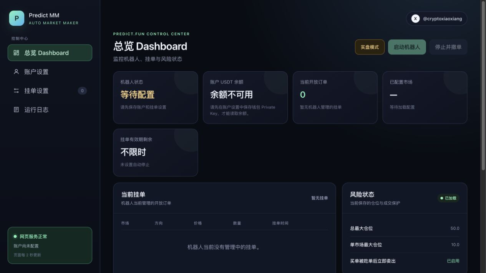

# Predict.fun Market making bot 自动做市机器人

[简体中文](README.md) | [English](README.en.md)

Predict.fun 自动做市工具，提供网页控制台、多市场挂单、自动撤单重报价和成交监测。支持 Windows 桌面版，以及 Ubuntu/Debian VPS 部署。

**[下载 Windows 桌面版](https://github.com/Cryptoxiaoxiang/predict-mm-bot/releases/download/v0.1.0-windows-preview.1/PredictMMBot-Windows-x64.zip)** · [Windows 使用方法](#windows-桌面版) · [VPS 一键安装](#一条命令安装到服务器推荐)

> 本工具不能保证订单永远不会成交。任何放在订单簿上的订单都有成交风险。第一次使用请尝试模拟运行，并从很小的金额开始。



## 功能简介

- 网页控制台：在浏览器中配置账户、管理市场、启停机器人并查看运行状态。
- 市场网址识别：粘贴市场网址，即可识别市场并选择挂单选项。
- 多市场运行：同时管理多个市场，分别设置挂单选项和数量。
- 自动挂单与撤单：根据盘口自动报价，按设置的存活时间管理和更新订单。
- 短期订单保护：撤单时快速移出订单簿，限价单签名最长 300 秒后自动过期。
- 价格接近保护：实时监测盘口，价格逼近挂单时优先撤单，断线后自动切换为定期检查。
- 买盘深度保护：前方买盘不足或快速减少时提前撤单，恢复稳定后再挂单，保护阈值可自行调整。
- 成交实时监测：结合实时推送和订单查询，及时发现买单成交。
- 紧急卖出保护：收到买入撮合通知后暂停对应市场并尝试卖出，份额不足时自动重试；可能使用账户原有的同选项持仓，不保证成交速度或价格。
- 运行日志：查看挂单、撤单和成交保护记录，方便排错与复盘。

## 开始前

你需要：

- 为了安全最好注册一个新钱包使用, Predictfun 注册链接，可以获得30%手续费折扣: https://predict.fun?ref=5BA3F 
- 需要 Predict.fun API Key 和钱包私钥；网页会自动生成 JWT Token。

## 账户配置

- 申请API key, 打开开发者网站申请 https://developers.predict.fun/ ， 教程参考 https://x.com/cryptoxiaoxiang/status/2095794263439397155
- 在Predict fun网页版点右上角头像，复制用户名下的钱包地址
- 导出 Privy 的私钥，在 Predict.fun 官网点头像 → 设置 → 导出 Privy 私钥
- 将上面复制的钱包地址、API Key，以及 Privy 私钥填入机器人控制台的账户设置中就完成了
- 如果是新钱包，需要在网页上完成一笔任意交易，会自动完成授权

## Windows 桌面版

1. 打开 **[Windows 下载页面](https://github.com/Cryptoxiaoxiang/predict-mm-bot/releases)**，在 **Assets** 中下载 `PredictMMBot-Windows-x64.zip`。
2. 解压整个压缩包，保留 `PredictMMBot.exe` 和 `_internal` 文件夹，双击 `PredictMMBot.exe`。
3. 在“账户设置”填写 API Key、钱包地址和私钥；保存账户和挂单设置后，点击“启动机器人”。

支持 Windows 10/11 64 位，不需要安装 Python。需要 Microsoft Edge WebView2 Runtime，缺少时可从[微软官网](https://developer.microsoft.com/microsoft-edge/webview2/)安装。首个 Windows 版本为预览版，沿用现有中文控制台；英文 README 是使用说明的语言切换，不会改变应用界面语言。

双击应用只会打开控制台，不会自动开始挂单。正常关闭窗口时，应用会先请求停止机器人并等待撤单流程结束；无法确认完成时会保持窗口打开并提示原因。电脑睡眠、关机或强制结束应用会中断本地机器人。

账户配置、日志和订单记录保存在 `%LOCALAPPDATA%\PredictMMBot`，更新应用时无需重新输入账户设置。不要将这个目录或里面的 `.env` 文件发送给别人。更新前先停止并撤单、关闭应用，再解压新版到一个新文件夹。

下载页面中的 `Source code` 是源码，普通 Windows 用户请选择 `PredictMMBot-Windows-x64.zip`。长期无人值守运行建议使用下面的 VPS 版本。

## 一条命令安装到服务器（推荐）

建议使用 Ubuntu 24.04 云服务器。通过 SSH 登录服务器后，复制并执行下面这一条命令：

```bash
curl -fsSL https://codeload.github.com/Cryptoxiaoxiang/predict-mm-bot/tar.gz/refs/heads/main | tar -xzO predict-mm-bot-main/install.sh > /tmp/predict-mm-install.sh && sudo bash /tmp/predict-mm-install.sh
```

如果当前登录的就是 `root` 用户，也可以去掉命令中的 `sudo`。脚本会自动完成：

- 安装 Python、虚拟环境和下载工具；
- 下载或更新机器人；
- 安装网页运行依赖；
- 创建受系统管理的后台服务；
- 启动网页控制台，并设置服务器重启后自动恢复；
- 更新时保留已有的 `.env`、`config.toml` 和日志；
- 首次改用一键安装时，自动迁移 `/root/predict-mm-bot` 中已有的账户和市场设置。

脚本只支持 Ubuntu/Debian，推荐 Ubuntu 24.04。如果检测到 Python 低于 3.11、端口被其他程序占用，或机器人仍在运行，脚本会停止并显示原因，不会强行覆盖或中断实盘机器人。

以后需要更新到 GitHub 最新版时，先在网页点击“停止并撤单”，然后再次执行同一条安装命令即可。

启动服务：
```bash
sudo systemctl start predict-mm-bot && timeout 30 bash -c 'until curl -fsS http://127.0.0.1:8080/api/status >/dev/null; do sleep 1; done' && curl -fsS -X POST http://127.0.0.1:8080/api/start
```

## 打开网页控制台

网页只监听服务器本机，不会直接暴露到公网，保证安全。安装完成后，在**自己的本地电脑**打开一个新的终端窗口并输入：

```bash
ssh -L 8080:127.0.0.1:8080 用户名@服务器IP
```

`用户名` 可以是 `root`，很多云主机服务商默认是ubuntu,自己确认，然后保持这个 SSH 窗口打开，在自己电脑的浏览器访问 `http://127.0.0.1:8080`。

关闭这个 SSH 窗口只会断开网页访问通道，VPS 上的网页服务和已经启动的机器人仍会继续运行。如果电脑重启或者休眠，要重新输入一遍上面命令打开ssh通道才能访问网页

## 服务管理与排错

查看实时日志：

```bash
sudo journalctl -u predict-mm-bot -f
```

重新启动网页服务：

```bash
sudo systemctl restart predict-mm-bot
```

重启或更新前，应先在网页点击“停止并撤单”。系统服务重启后只会恢复网页控制台，机器人不会自动开始实盘挂单。


## 命令行方式

不使用网页时，仍可通过命令行首次配置并直接启动：

```bash
python -m predict_mm.main --config config.toml
```

## 挂单设置

- 直接将Predictfun的市场的网址复制填入控制台中，点击识别网址将自动获取Market ID， 如果该市场有多个选项，将会询问用户选择
- 填完挂单信息后保存点击启动机器人就好了。


## 账户安全

- `.env` 和 `config.toml` 不会被提交到 GitHub；不要把它们发送给任何人。
- 不要在聊天、截图或公开仓库中暴露 API Key、JWT Token 或私钥。
- 程序启动和停止时会尝试撤销它管理的开放订单；即使如此，也应在每次实盘后到 Predict.fun 页面核对开放订单。
